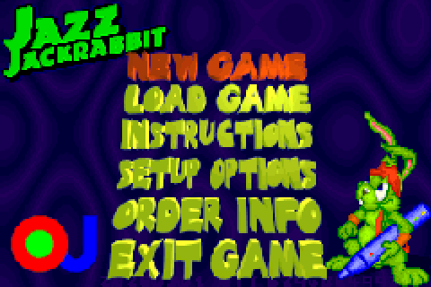
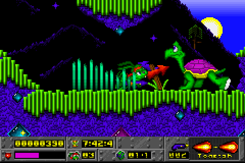
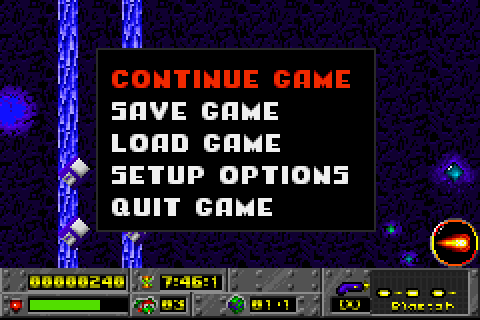
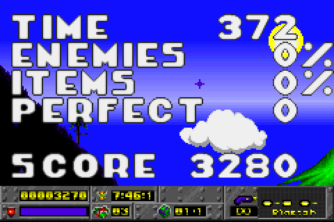
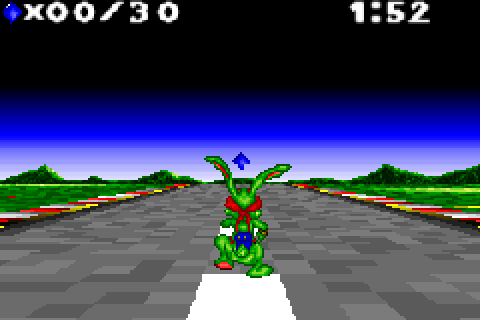

# ![OJ Logo][logo] OpenJazz Advance: _Jazz Jackrabbit_ on the Game Boy Advance

A fork of [**OpenJazz**](https://github.com/AlisterT/openjazz) by AJ Thomson, Carsten Teibes and [contributors](res/unix/OpenJazz.6.adoc#authors)

OpenJazz is a free, open-source version of the classic _Jazz Jackrabbit™_ games, which runs on Windows, macOS, Linux, BSD and many homebrew platforms. **OpenJazz Advance** adds one more: **the Game Boy Advance**, as a cartridge ROM with the game data built in.

The port runs OpenJazz's own engine. The GBA code lives in `src/platforms/gba` and behind the platform's defines. Where the port needed changes to shared code (smaller level data, faster loading, drawing fixes), the desktop game still draws exactly the same frames, which `tools/gba/detcompare.sh` checks. The desktop builds work as in upstream OpenJazz.

This is a work in progress: see [Status](#status).

## Game Data

No game data is included. You need the files from one of the original _Jazz Jackrabbit_ games. The port has been developed and tested with the CD version.

The GBA build puts the game data inside the ROM, so a ROM carries the same restrictions as the data files it was built from: **don't share ROMs** built from the registered or CD versions.

## Game Boy Advance

### Screenshots

| | |
|:-:|:-:|
|  |  |
| The main menu | Gameplay, drawn with the GBA's tile and sprite hardware |
|  |  |
| The in-level menu (Start) | Level end statistics |
|  |  |
| Approaching the next planet | A bonus level |

Screenshots are from Episode 1 of the CD version, taken in mGBA and shown at twice the GBA's resolution.

### Building

Requirements:

* The devkitPro GBA toolchain. Install devkitPro's pacman (see [Getting Started](https://devkitpro.org/wiki/Getting_Started)), then run `sudo dkp-pacman -S gba-dev` and `source /etc/profile.d/devkit-env.sh`.
* CMake, a C++ compiler and the SDL2 development package for Linux, to build the desktop program that bakes the game data.

The GBA has 256 KB of RAM, against the 1 MB or more that a level takes on the desktop. So graphics are decoded ahead of time, on the desktop, into a game data pack that the ROM uses in place. Bake the pack from your game directory first:

    cmake -B build-bake -DBAKE=ON -DCMAKE_BUILD_TYPE=Release
    cmake --build build-bake
    OJ_BAKE=/path/to/jazz OJ_BAKE_OUT=ojpack.bin SDL_VIDEODRIVER=dummy SDL_AUDIODRIVER=dummy \
        ./build-bake/OpenJazz -q --no-logfile /path/to/jazz

Then build the ROM with the pack in it:

    cmake -B build-gba -DCMAKE_TOOLCHAIN_FILE=$DEVKITPRO/cmake/GBA.cmake -DGBA_PACK=$PWD/ojpack.bin
    cmake --build build-gba     # builds build-gba/OpenJazz.gba

The ROM is about 22 MB, so a flash cartridge needs to take 32 MB ROMs. It has been tested in [mGBA](https://mgba.io/), not yet on a GBA.

### Controls

| Button | Does                                  | PC key it stands for |
|--------|---------------------------------------|----------------------|
| D-pad  | Move; look up and down; move in menus | Arrow keys           |
| A      | Jump and swim; choose in menus        | Space                |
| B      | Fire                                  | Alt                  |
| R      | Change weapon                         | Right Ctrl           |
| L      | Pause                                 | P                    |
| Start  | In-level menu; go back in menus       | Escape               |
| Select | Frame rate statistics                 | F9                   |

### Differences From the Desktop Game

* **A smaller view.** Levels are drawn at the GBA's own 240x160 with its tile layers and hardware sprites, so they run at 60 frames per second but show less of the level than the desktop's 320x200. The panel at the bottom is scaled to fit the width.
* **Scaled screens.** Menus, the planet screen and bonus levels are drawn at 320x200 and scaled down to the screen.
* **Faster loading.** Files are read straight from the game data pack in ROM.

### Status

Working: the menus, the menu demos, levels at 60 frames per second (tested mostly in Episode 1), dying and reloading, level end statistics, bonus levels and moving on to the next level.

Not done yet:

* **No sound or music.** Converting the music to Maxmod is planned.
* **No saving.** Neither games nor settings are saved; the cartridge's SRAM is not used yet.
* **Cutscenes.** The startup cutscene is skipped, and the cutscenes between worlds haven't been tried.
* **Bonus levels run at about 13 frames per second.** Their floor is drawn pixel by pixel; the GBA's rotation backgrounds could do it in hardware, but don't fit these levels as they are.
* Most worlds after Episode 1 haven't been played through on the GBA.

### Tools

`tools/gba` has the tools used to develop the port: a headless runner built on mGBA's core for screenshots, scripted key presses, profiling and frame rate counts, benchmarks, and the desktop frame comparison. See [tools/gba/README.md](tools/gba/README.md).

## Desktop

The desktop builds are unchanged from upstream OpenJazz: see [Building][building] and [Platforms][platforms]. Execute `OpenJazz` with the game directory as its argument, or with the data files alongside the executable. See the [manual](res/unix/OpenJazz.6.adoc#ingame-controls) for the controls.

## License

OpenJazz is available under the GNU General Public License version 2 or later, see [licenses.txt][licenses] for additional information and other included software.

## Authors

- Original author: AJ Thomson (alister_j_t at yahoo dot com)
- Current Maintainer: Carsten Teibes (dev f4ke de)
- Game Boy Advance port: Berobloom

[Additional Authors](res/unix/OpenJazz.6.adoc#authors) (See manual)

Homepage of OpenJazz: http://alister.eu/jazz/oj/

[logo]: res/unix/OpenJazz.png
[platforms]: doc/PLATFORMS.md
[licenses]: doc/licenses.txt
[building]: doc/BUILDING.md
